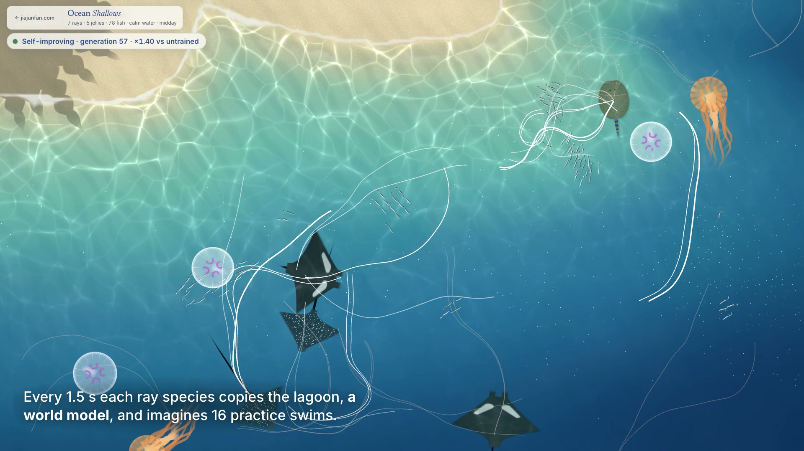

# Aquatic RSI world model

Multi-agent self-improvement with a world model, in a small live lagoon in the browser: many rays learn to
forage at once by practising in a copy of their world, while you watch and change the world under them. It runs publicly as **Ocean Shallows**:
<https://www.jiajunfan.com/lab/shallows/>.

The code in `web/` is the same code the site serves. There is no build step and no server-side part.

[](media/ocean_shallows_promo.mp4)

A 42 s film recorded from the real simulation ([`media/ocean_shallows_promo.mp4`](media/ocean_shallows_promo.mp4)):
the white loops are one generation's imagined practice swims in the world model, and the badge is the live
learned-vs-untrained check.

## The world

- **Creatures.** Manta rays and eagle rays swim in deeper water, stingrays keep to the sandy shallows (and
  sometimes settle on the sand), moon jellies and sea nettles drift with the water, and schools of small silver
  fish (boids) school, follow the plankton scent, flee rays, nettles and your finger, and eat plankton, so fish and
  rays compete for the same food.
- **Food.** Plankton blooms appear on their own and wherever you tap. Each bloom spreads a scent field that a
  ray can sense on its left and right.
- **Danger.** Sea nettles sting rays that swim into the zone behind their bells.
- **Weather.** Calm, rain (blooms come faster and the scent gets noisy), a current, and a whirlpool.

## How the rays improve themselves

Each generation is one loop, and it runs about every 1.5 s of lagoon time:

1. **Copy** the lagoon. The copy starts exactly as the lagoon is now (the same water, plankton and nettles) and
   is a simplified world model: each practice swim is one ray alone, the plankton neither drifts nor regrows,
   and the nettles coast on with the water.
2. **Imagine** 16 practice swims per ray species in the copy, each with a slightly changed habit.
3. **Keep** the changes that ate more plankton and took fewer stings.
   Each species also **learns how to learn**: its exploration size grows while successive gradient estimates
   agree and shrinks when they conflict. In the 54 test cases below this left no case without a gain (worst
   1.06x over untrained, vs 1.00x for a fixed size), with a similar mean gain (1.41x vs 1.38x).
4. **Act** with the new habit in the real lagoon, which keeps changing as you tap and switch the weather.

The page draws each generation's imagined swims on the water as faint white lines (brighter = scored better;
switch them off in the learning panel), and the panel charts learned vs untrained over generations.

## How the rays learn (details)

Each ray species shares one habit: twelve numbers that map six things a ray senses (scent left vs right, food
under its mouth, nettles left vs right, the current, the edge of its water, a constant) to how hard it turns
and how fast it swims. Two of those numbers are learned: how strongly to follow the scent and how strongly to
steer clear of nettles. The rest stay at zero.

About every 1.5 s of lagoon time, the trainer copies the current lagoon and runs 16 practice swims per species
in the copy (8 mirrored pairs of 12 s, evolution strategies with centred ranks and Adam). The habit moves
toward the swims that scored better. A swim's score is the plankton it ate, minus 2 per second spent being
stung, minus a small swimming effort, minus 1 per second spent at the very edge of its water. Nothing is
pre-trained: every page load starts from zero.

**Checked, not assumed.** The page keeps measuring the learned habit against an untrained one: both swim the
same copied lagoon from the same starts with the same noise, and the learning panel shows the plankton ratio.
The first check runs at generation 15 (about 22 s of lagoon time), then every 20 s. The lagoon changes between
checks, so the badge at the top pools each ray species' last three checks (about a minute of checks), the same
numbers the panel's rows and chart show. In a replay of the page over 24 lagoons (`tests/badge_noise.mjs`) this cut
the mean check-to-check change of the number from 0.35 to 0.12, while tripling the swims per check only took it to
0.31.
`tests/learning.mjs` runs the same kind of comparison offline, in a lagoon without the fish (60 swims of 24 s
per species instead of the page's 12 pairs of 18 s). Over 9 lagoons (seeds 1, 2, 3, 4, 5, 7, 11, 21 and 42),
with a tap every 5 s and without, and all three ray species (54 cases), the learned habit ate 1.06 to 2.31
times as much plankton as the untrained one after 60 generations (mean 1.41). With the exploration size held
fixed (`fixed`), the range was 1.00 to 3.36 (mean 1.38), with one case no better than untrained (1.002x).

## Things you can do

- Tap the water to scatter plankton; move the pointer across it to stir ripples.
- Tap a creature to startle it (rays dart away, a resting stingray lifts off the sand, jellies jet away);
  with sound on, each species plays the water it moves (none of these animals calls). Drag a creature to lead it.
- Tap a species in the toolbar to add one, drag its icon onto the water to place it, hold it to remove one.
- Switch the weather, open the learning panel, turn on sound, hide the controls, pause.
- Keys: 1-5 add a species (Shift removes), C / R / U / W weather, S sound, L learning panel, H hide, Space pause.

With reduced motion turned on the lagoon starts still and is drawn only when something changes.

## Run it

```bash
cd web && python3 -m http.server 8000
```

Then open <http://localhost:8000/>. Add `?seed=7` for a repeatable lagoon, or `?fast` to train as fast as the
frame budget allows. Three.js 0.160.0 is loaded from jsDelivr, so the first load needs a network connection.

## Tests

```bash
node tests/learning.mjs 7 5          # lagoon seed 7, a tap every 5 s; prints learned vs untrained plankton per species
node tests/learning.mjs 7 5 fixed    # the same with a fixed exploration size
node tests/entering.mjs              # every ray added from the toolbar is in the lagoon within 8 s (it swims in,
                                     # or an 8 s fallback places it in open water; placedByFallback counts those)
node --import ./tests/no_three.mjs tests/badge_noise.mjs   # how steady the live check is (about 2 min)
```

## Record the film

```bash
cd web && python3 -m http.server 8000      # in another terminal
python3 tools/record_video.py out/         # needs Chrome, ffmpeg and `pip install websocket-client`
```

The page opened with `?capture` stops its own real-time loop, and the script steps the lagoon by exact frames
and screenshots each one, so the film is smooth on any machine. It warms up for 60 s of lagoon time (the rays
learn from zero during it), then films 42 s; captions, title and end cards are plain DOM on top of the page.

## Files

| file | what it holds |
| --- | --- |
| `web/env.js` | the world: depth map, species, plankton and scent, nettles, weather, ripples, one step of every creature |
| `web/gym.js` | features, the habit, practice swims and the evolution-strategies trainer |
| `web/shallows.js` | the page: sizing, the main loop, pointer handling, the live learned-vs-untrained check |
| `web/water.js` | the water shader (sand, depth colour, caustics, ripples, rain, shadows) |
| `web/creatures.js` | ray and jelly meshes and shaders, tails and tentacles, shadows, picking |
| `web/ui.js` | toolbar, census, learning panel, hints, keyboard |
| `web/fish.js` | schools of fish: the boids rules, foraging, fleeing, and their instanced drawing |
| `web/sound.js` | optional surf, rain, notes and per-species touch sounds |
| `tools/record_video.py` | records the film from the live simulation (see above) |
